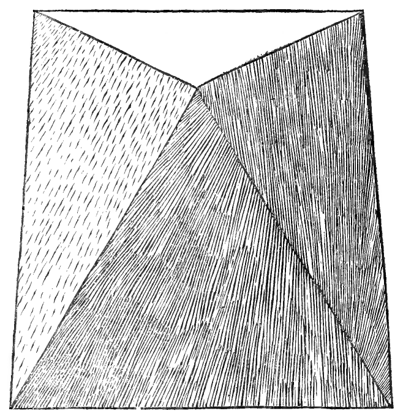

:layout: book
:canonical_id: Tabula XV
:folio: 0219

.. _plates-polyhedra-plate_15-la:

Tabula XV (Folio 0219) — Octahedron Planum Solidum
==================================================

.. rubric:: Figura Geometrica per Manum Leonardi Vincii (1509)

.. folio:: 0219

   :term:`*Octahedron Planum Solidum* <octahedron>` (:term:`Ὀκτάεδρον <octahedron>` :term:`ἐπίπεδον <planum>` :term:`στερεόν <solidum>`)
