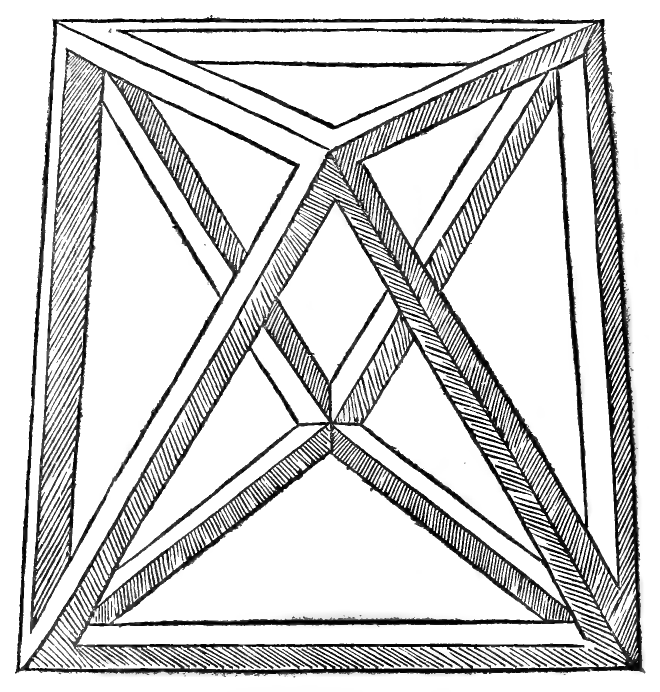

:layout: book
:canonical_id: Plate XVI
:folio: 0221

.. _plates-polyhedra-plate_16:
.. _plates-polyhedra-plate_16-en:

Plate XVI (Folio 0221) — Hollow Regular Octahedron
==================================================

.. rubric:: Perspective Woodcut by Leonardo da Vinci (1509)

.. folio:: 0221

   **Hollow Regular Octahedron** — :term:`*Octahedron Planum Vacuum* <octahedron>` (:term:`Ὀκτάεδρον <octahedron>` :term:`ἐπίπεδον <planum>` :term:`κενόν <vacuum>`)
