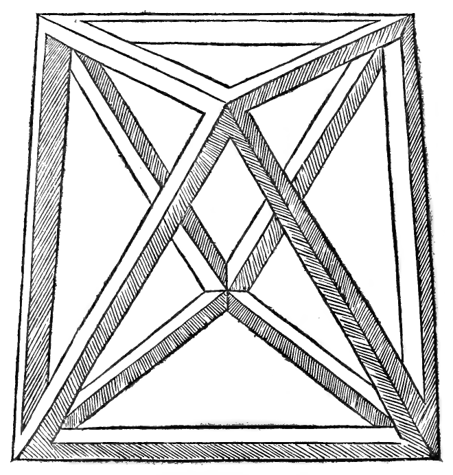

:layout: book
:canonical_id: Tabula XVI
:folio: 0221

.. _plates-polyhedra-plate_16-la:

Tabula XVI (Folio 0221) — Octahedron Planum Vacuum
==================================================

.. rubric:: Figura Geometrica per Manum Leonardi Vincii (1509)

.. folio:: 0221

   :term:`*Octahedron Planum Vacuum* <octahedron>` (:term:`Ὀκτάεδρον <octahedron>` :term:`ἐπίπεδον <planum>` :term:`κενόν <vacuum>`)
