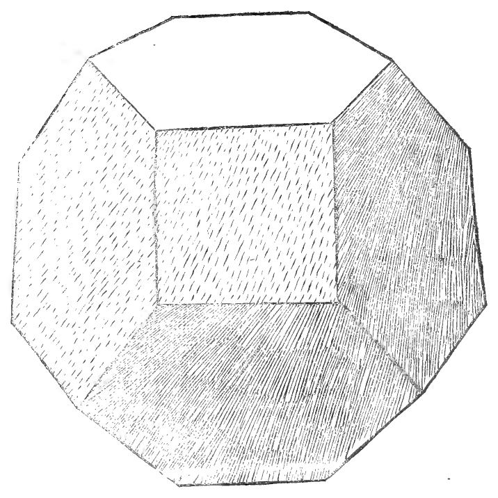

:layout: book
:canonical_id: Plate XVII
:folio: 0223

.. _plates-polyhedra-plate_17:
.. _plates-polyhedra-plate_17-en:

Plate XVII (Folio 0223) — Solid Truncated Octahedron
====================================================

.. rubric:: Perspective Woodcut by Leonardo da Vinci (1509)

.. folio:: 0223

   **Solid Truncated Octahedron** — :term:`*Octahedron Abscisum Solidum* <octahedron-abscisum>` (:term:`Ὀκτάεδρον ἀποτετμημένον <octahedron-abscisum>` :term:`στερεόν <solidum>`)
