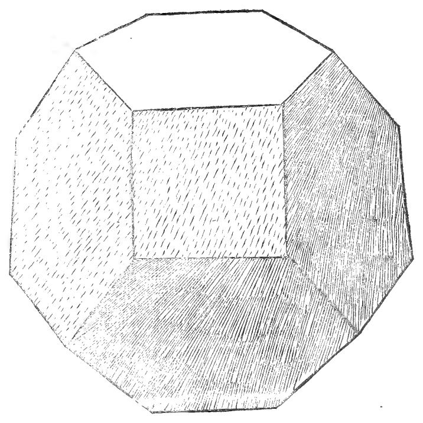

:layout: book
:canonical_id: Tabula XVII
:folio: 0223

.. _plates-polyhedra-plate_17-la:

Tabula XVII (Folio 0223) — Octahedron Abscisum Solidum
======================================================

.. rubric:: Figura Geometrica per Manum Leonardi Vincii (1509)

.. folio:: 0223

   :term:`*Octahedron Abscisum Solidum* <octahedron-abscisum>` (:term:`Ὀκτάεδρον ἀποτετμημένον <octahedron-abscisum>` :term:`στερεόν <solidum>`)
