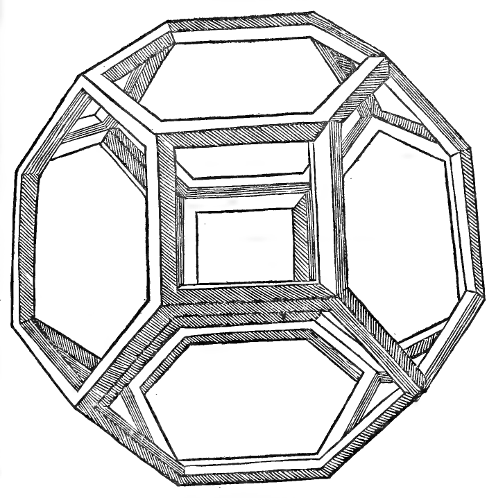

:layout: book
:canonical_id: Plate XVIII
:folio: 0225

.. _plates-polyhedra-plate_18:
.. _plates-polyhedra-plate_18-en:

Plate XVIII (Folio 0225) — Hollow Truncated Octahedron
======================================================

.. rubric:: Perspective Woodcut by Leonardo da Vinci (1509)

.. folio:: 0225

   **Hollow Truncated Octahedron** — :term:`*Octahedron Abscisum Vacuum* <octahedron-abscisum>` (:term:`Ὀκτάεδρον ἀποτετμημένον <octahedron-abscisum>` :term:`κενόν <vacuum>`)
