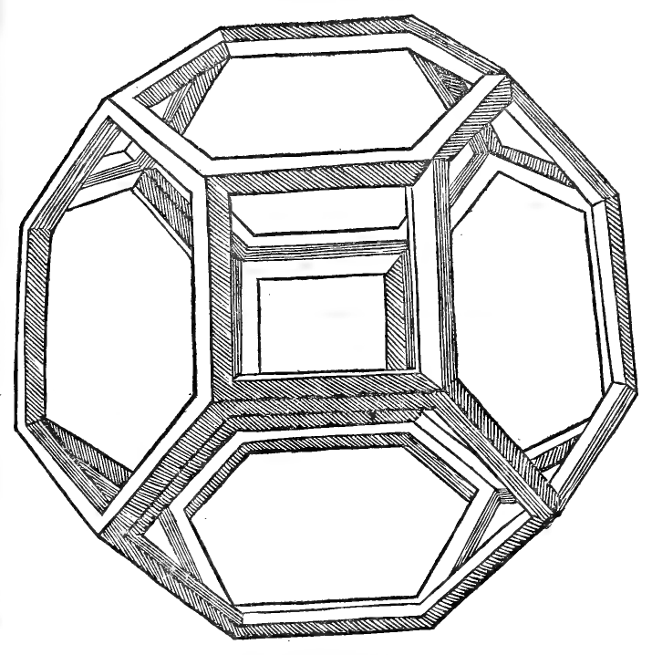

:layout: book
:canonical_id: Tabula XVIII
:folio: 0225

.. _plates-polyhedra-plate_18-la:

Tabula XVIII (Folio 0225) — Octahedron Abscisum Vacuum
======================================================

.. rubric:: Figura Geometrica per Manum Leonardi Vincii (1509)

.. folio:: 0225

   :term:`*Octahedron Abscisum Vacuum* <octahedron-abscisum>` (:term:`Ὀκτάεδρον ἀποτετμημένον <octahedron-abscisum>` :term:`κενόν <vacuum>`)
