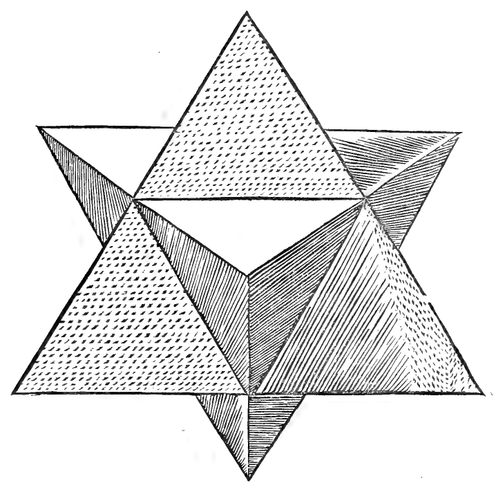

:layout: book
:canonical_id: Plate XIX
:folio: 0227

.. _plates-polyhedra-plate_19:
.. _plates-polyhedra-plate_19-en:

Plate XIX (Folio 0227) — Solid Elevated Octahedron (Stella Octangula)
=====================================================================

.. rubric:: Perspective Woodcut by Leonardo da Vinci (1509)

.. folio:: 0227

   **Solid Elevated Octahedron (Stella Octangula)** — :term:`*Octahedron Elevatum Solidum* <octahedron-elevatum>` (:term:`Ὀκτάεδρον ἐπηρμένον <octahedron-elevatum>` :term:`στερεόν <solidum>`)
