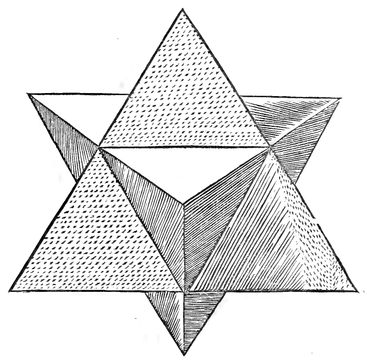

:layout: book
:canonical_id: Tabula XIX
:folio: 0227

.. _plates-polyhedra-plate_19-la:

Tabula XIX (Folio 0227) — Octahedron Elevatum Solidum
=====================================================

.. rubric:: Figura Geometrica per Manum Leonardi Vincii (1509)

.. folio:: 0227

   :term:`*Octahedron Elevatum Solidum* <octahedron-elevatum>` (:term:`Ὀκτάεδρον ἐπηρμένον <octahedron-elevatum>` :term:`στερεόν <solidum>`)
