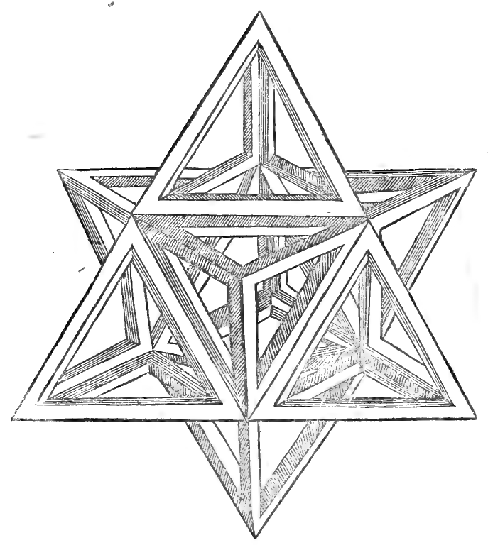

:layout: book
:canonical_id: Plate XX
:folio: 0229

.. _plates-polyhedra-plate_20:
.. _plates-polyhedra-plate_20-en:

Plate XX (Folio 0229) — Hollow Elevated Octahedron (Stella Octangula)
=====================================================================

.. rubric:: Perspective Woodcut by Leonardo da Vinci (1509)

.. folio:: 0229

   **Hollow Elevated Octahedron (Stella Octangula)** — :term:`*Octahedron Elevatum Vacuum* <octahedron-elevatum>` (:term:`Ὀκτάεδρον ἐπηρμένον <octahedron-elevatum>` :term:`κενόν <vacuum>`)
