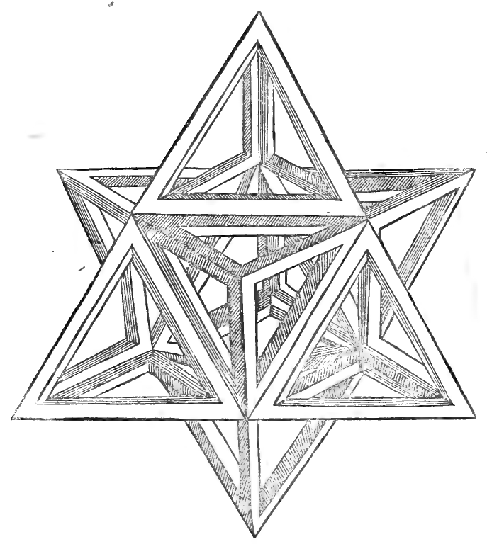

:layout: book
:canonical_id: Tabula XX
:folio: 0229

.. _plates-polyhedra-plate_20-la:

Tabula XX (Folio 0229) — Octahedron Elevatum Vacuum
===================================================

.. rubric:: Figura Geometrica per Manum Leonardi Vincii (1509)

.. folio:: 0229

   :term:`*Octahedron Elevatum Vacuum* <octahedron-elevatum>` (:term:`Ὀκτάεδρον ἐπηρμένον <octahedron-elevatum>` :term:`κενόν <vacuum>`)
