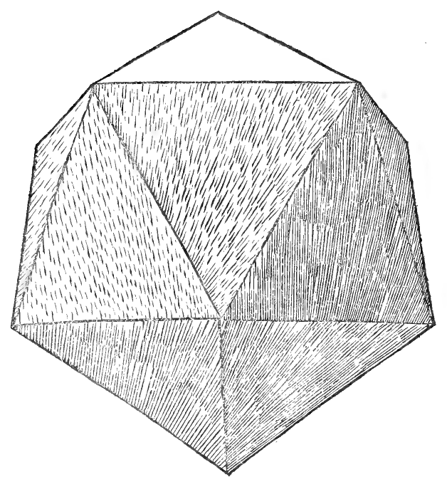

:layout: book
:canonical_id: Plate XXI
:folio: 0231

.. _plates-polyhedra-plate_21:
.. _plates-polyhedra-plate_21-en:

Plate XXI (Folio 0231) — Solid Regular Icosahedron
==================================================

.. rubric:: Perspective Woodcut by Leonardo da Vinci (1509)

.. folio:: 0231

   **Solid Regular Icosahedron** — :term:`*Icosahedron Planum Solidum* <icosahedron>` (:term:`Εἰκοσάεδρον <icosahedron>` :term:`ἐπίπεδον <planum>` :term:`στερεόν <solidum>`)
