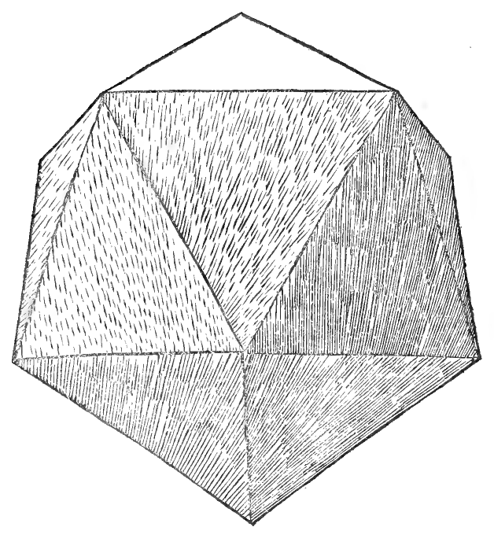

:layout: book
:canonical_id: Tabula XXI
:folio: 0231

.. _plates-polyhedra-plate_21-la:

Tabula XXI (Folio 0231) — Icosahedron Planum Solidum
====================================================

.. rubric:: Figura Geometrica per Manum Leonardi Vincii (1509)

.. folio:: 0231

   :term:`*Icosahedron Planum Solidum* <icosahedron>` (:term:`Εἰκοσάεδρον <icosahedron>` :term:`ἐπίπεδον <planum>` :term:`στερεόν <solidum>`)
