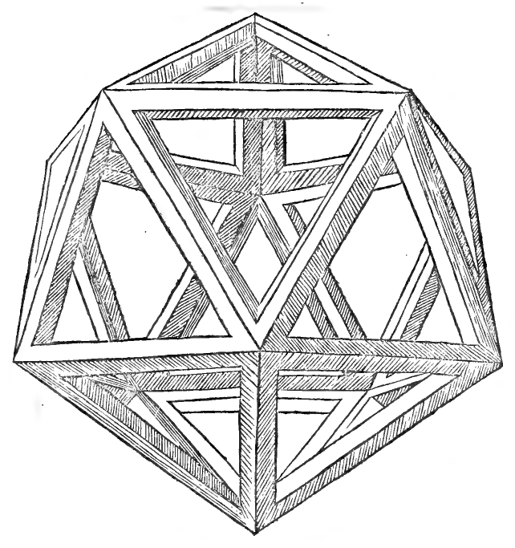

:layout: book
:canonical_id: Plate XXII
:folio: 0233

.. _plates-polyhedra-plate_22:
.. _plates-polyhedra-plate_22-en:

Plate XXII (Folio 0233) — Hollow Regular Icosahedron
====================================================

.. rubric:: Perspective Woodcut by Leonardo da Vinci (1509)

.. folio:: 0233

   **Hollow Regular Icosahedron** — :term:`*Icosahedron Planum Vacuum* <icosahedron>` (:term:`Εἰκοσάεδρον <icosahedron>` :term:`ἐπίπεδον <planum>` :term:`κενόν <vacuum>`)
