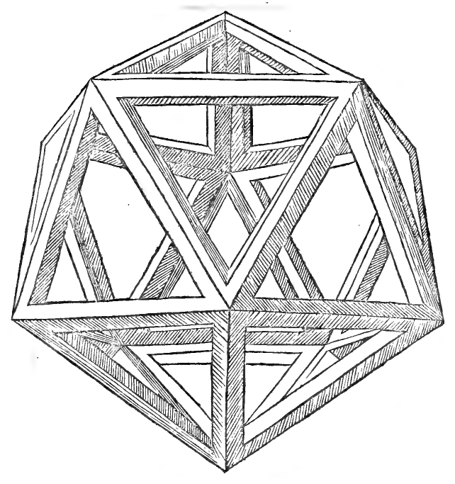

:layout: book
:canonical_id: Tabula XXII
:folio: 0233

.. _plates-polyhedra-plate_22-la:

Tabula XXII (Folio 0233) — Icosahedron Planum Vacuum
====================================================

.. rubric:: Figura Geometrica per Manum Leonardi Vincii (1509)

.. folio:: 0233

   :term:`*Icosahedron Planum Vacuum* <icosahedron>` (:term:`Εἰκοσάεδρον <icosahedron>` :term:`ἐπίπεδον <planum>` :term:`κενόν <vacuum>`)
