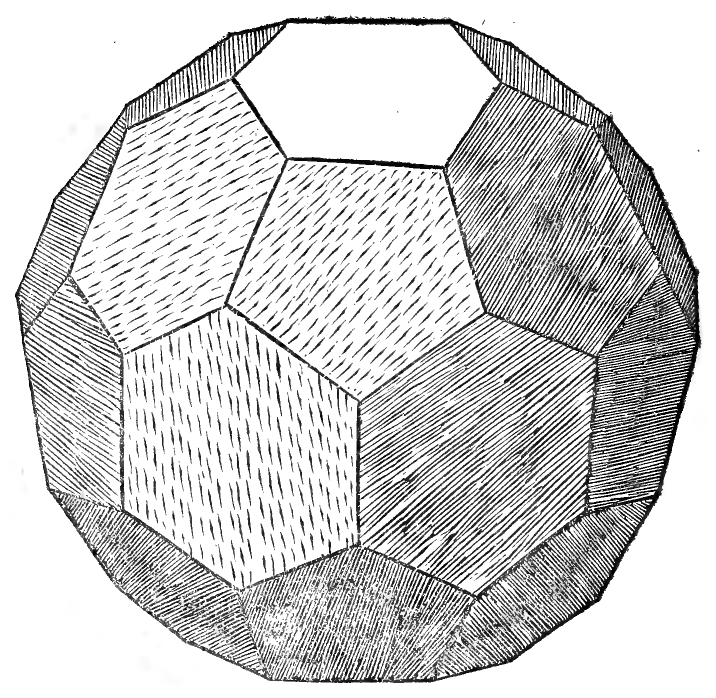

:layout: book
:canonical_id: Plate XXIII
:folio: 0235

.. _plates-polyhedra-plate_23:
.. _plates-polyhedra-plate_23-en:

Plate XXIII (Folio 0235) — Solid Truncated Icosahedron
======================================================

.. rubric:: Perspective Woodcut by Leonardo da Vinci (1509)

.. folio:: 0235

   **Solid Truncated Icosahedron** — :term:`*Icosahedron Abscisum Solidum* <icosahedron-abscisum>` (:term:`Εἰκοσάεδρον ἀποτετμημένον <icosahedron-abscisum>` :term:`στερεόν <solidum>`)
