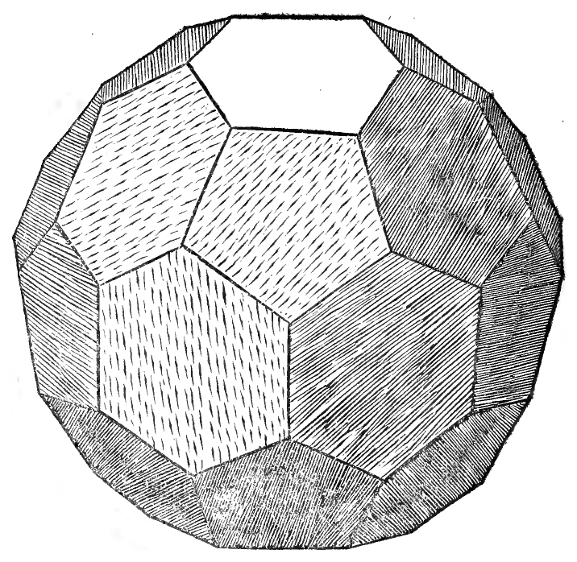

:layout: book
:canonical_id: Tabula XXIII
:folio: 0235

.. _plates-polyhedra-plate_23-la:

Tabula XXIII (Folio 0235) — Icosahedron Abscisum Solidum
========================================================

.. rubric:: Figura Geometrica per Manum Leonardi Vincii (1509)

.. folio:: 0235

   :term:`*Icosahedron Abscisum Solidum* <icosahedron-abscisum>` (:term:`Εἰκοσάεδρον ἀποτετμημένον <icosahedron-abscisum>` :term:`στερεόν <solidum>`)
