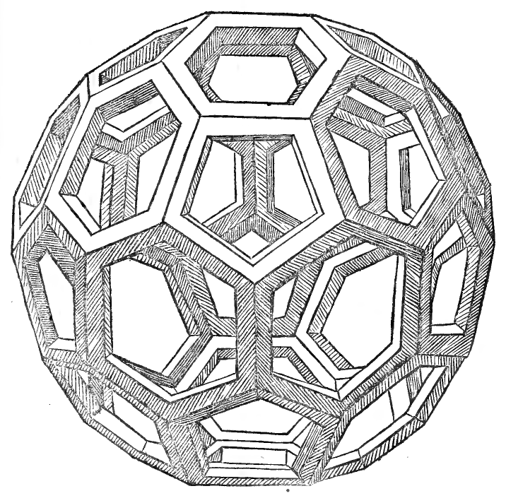

:layout: book
:canonical_id: Plate XXIIII
:folio: 0237

.. _plates-polyhedra-plate_24:
.. _plates-polyhedra-plate_24-en:

Plate XXIIII (Folio 0237) — Hollow Truncated Icosahedron
========================================================

.. rubric:: Perspective Woodcut by Leonardo da Vinci (1509)

.. folio:: 0237

   **Hollow Truncated Icosahedron** — :term:`*Icosahedron Abscisum Vacuum* <icosahedron-abscisum>` (:term:`Εἰκοσάεδρον ἀποτετμημένον <icosahedron-abscisum>` :term:`κενόν <vacuum>`)
