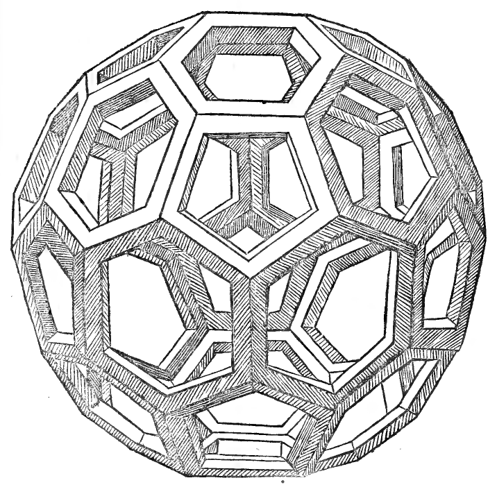

:layout: book
:canonical_id: Tabula XXIIII
:folio: 0237

.. _plates-polyhedra-plate_24-la:

Tabula XXIIII (Folio 0237) — Icosahedron Abscisum Vacuum
========================================================

.. rubric:: Figura Geometrica per Manum Leonardi Vincii (1509)

.. folio:: 0237

   :term:`*Icosahedron Abscisum Vacuum* <icosahedron-abscisum>` (:term:`Εἰκοσάεδρον ἀποτετμημένον <icosahedron-abscisum>` :term:`κενόν <vacuum>`)
