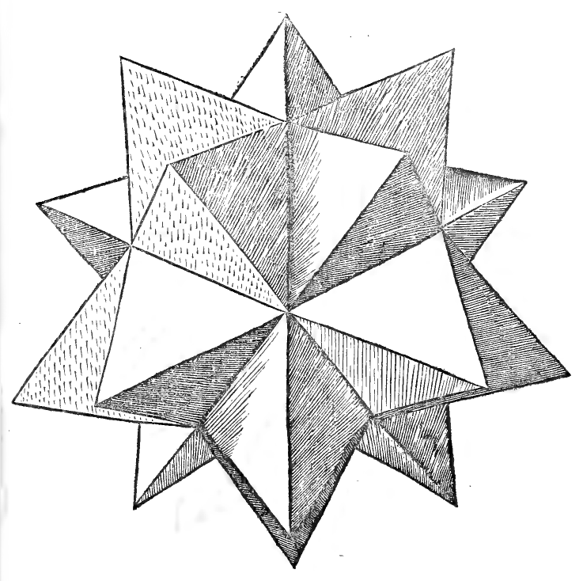

:layout: book
:canonical_id: Plate XXV
:folio: 0239

.. _plates-polyhedra-plate_25:
.. _plates-polyhedra-plate_25-en:

Plate XXV (Folio 0239) — Solid Elevated Icosahedron
===================================================

.. rubric:: Perspective Woodcut by Leonardo da Vinci (1509)

.. folio:: 0239

   **Solid Elevated Icosahedron** — :term:`*Icosahedron Elevatum Solidum* <icosahedron-elevatum>` (:term:`Εἰκοσάεδρον ἐπηρμένον <icosahedron-elevatum>` :term:`στερεόν <solidum>`)
