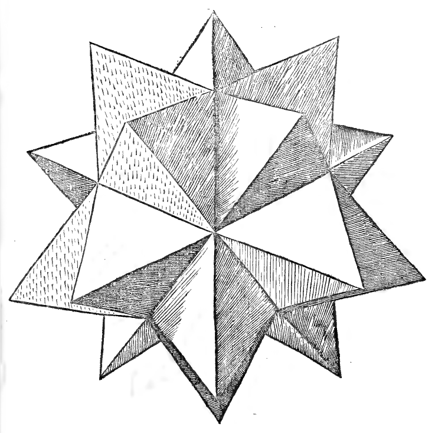

:layout: book
:canonical_id: Tabula XXV
:folio: 0239

.. _plates-polyhedra-plate_25-la:

Tabula XXV (Folio 0239) — Icosahedron Elevatum Solidum
======================================================

.. rubric:: Figura Geometrica per Manum Leonardi Vincii (1509)

.. folio:: 0239

   :term:`*Icosahedron Elevatum Solidum* <icosahedron-elevatum>` (:term:`Εἰκοσάεδρον ἐπηρμένον <icosahedron-elevatum>` :term:`στερεόν <solidum>`)
