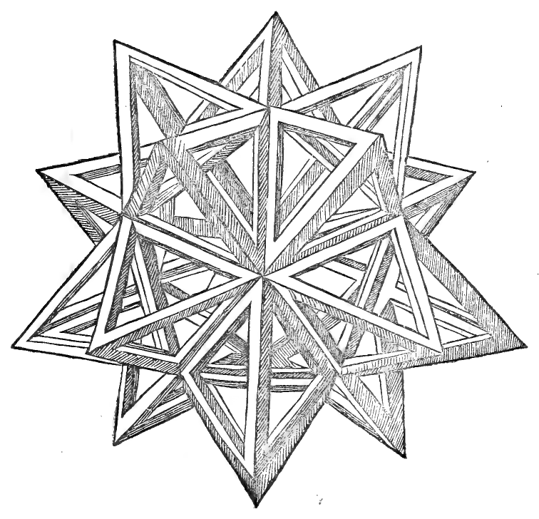

:layout: book
:canonical_id: Plate XXVI
:folio: 0241

.. _plates-polyhedra-plate_26:
.. _plates-polyhedra-plate_26-en:

Plate XXVI (Folio 0241) — Hollow Elevated Icosahedron
=====================================================

.. rubric:: Perspective Woodcut by Leonardo da Vinci (1509)

.. folio:: 0241

   **Hollow Elevated Icosahedron** — :term:`*Icosahedron Elevatum Vacuum* <icosahedron-elevatum>` (:term:`Εἰκοσάεδρον ἐπηρμένον <icosahedron-elevatum>` :term:`κενόν <vacuum>`)
