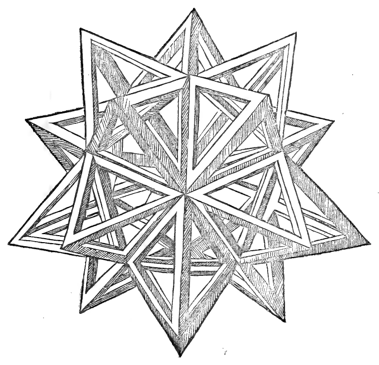

:layout: book
:canonical_id: Tabula XXVI
:folio: 0241

.. _plates-polyhedra-plate_26-la:

Tabula XXVI (Folio 0241) — Icosahedron Elevatum Vacuum
======================================================

.. rubric:: Figura Geometrica per Manum Leonardi Vincii (1509)

.. folio:: 0241

   :term:`*Icosahedron Elevatum Vacuum* <icosahedron-elevatum>` (:term:`Εἰκοσάεδρον ἐπηρμένον <icosahedron-elevatum>` :term:`κενόν <vacuum>`)
