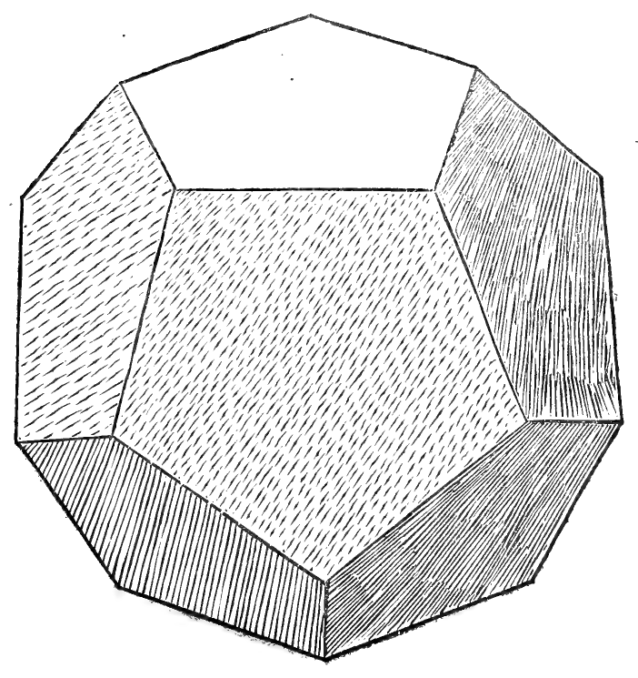

:layout: book
:canonical_id: Plate XXVII
:folio: 0243

.. _plates-polyhedra-plate_27:
.. _plates-polyhedra-plate_27-en:

Plate XXVII (Folio 0243) — Solid Regular Dodecahedron
=====================================================

.. rubric:: Perspective Woodcut by Leonardo da Vinci (1509)

.. folio:: 0243

   **Solid Regular Dodecahedron** — :term:`*Dodecahedron Planum Solidum* <dodecahedron>` (:term:`Δωδεκάεδρον <dodecahedron>` :term:`ἐπίπεδον <planum>` :term:`στερεόν <solidum>`)
