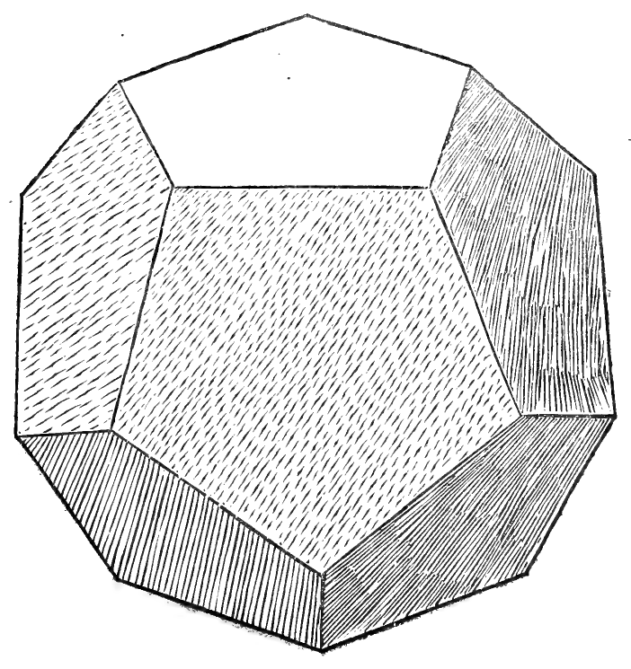

:layout: book
:canonical_id: Tabula XXVII
:folio: 0243

.. _plates-polyhedra-plate_27-la:

Tabula XXVII (Folio 0243) — Dodecahedron Planum Solidum
=======================================================

.. rubric:: Figura Geometrica per Manum Leonardi Vincii (1509)

.. folio:: 0243

   :term:`*Dodecahedron Planum Solidum* <dodecahedron>` (:term:`Δωδεκάεδρον <dodecahedron>` :term:`ἐπίπεδον <planum>` :term:`στερεόν <solidum>`)
