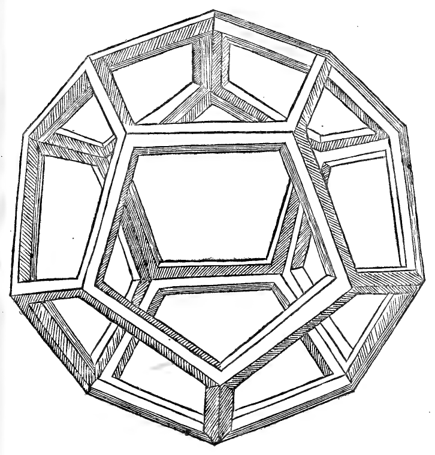

:layout: book
:canonical_id: Plate XXVIII
:folio: 0245

.. _plates-polyhedra-plate_28:
.. _plates-polyhedra-plate_28-en:

Plate XXVIII (Folio 0245) — Hollow Regular Dodecahedron
=======================================================

.. rubric:: Perspective Woodcut by Leonardo da Vinci (1509)

.. folio:: 0245

   **Hollow Regular Dodecahedron** — :term:`*Dodecahedron Planum Vacuum* <dodecahedron>` (:term:`Δωδεκάεδρον <dodecahedron>` :term:`ἐπίπεδον <planum>` :term:`κενόν <vacuum>`)
