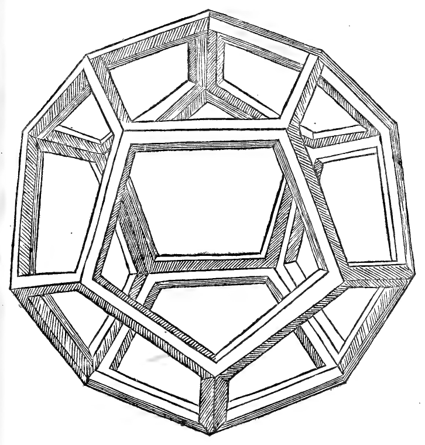

:layout: book
:canonical_id: Tabula XXVIII
:folio: 0245

.. _plates-polyhedra-plate_28-la:

Tabula XXVIII (Folio 0245) — Dodecahedron Planum Vacuum
=======================================================

.. rubric:: Figura Geometrica per Manum Leonardi Vincii (1509)

.. folio:: 0245

   :term:`*Dodecahedron Planum Vacuum* <dodecahedron>` (:term:`Δωδεκάεδρον <dodecahedron>` :term:`ἐπίπεδον <planum>` :term:`κενόν <vacuum>`)
