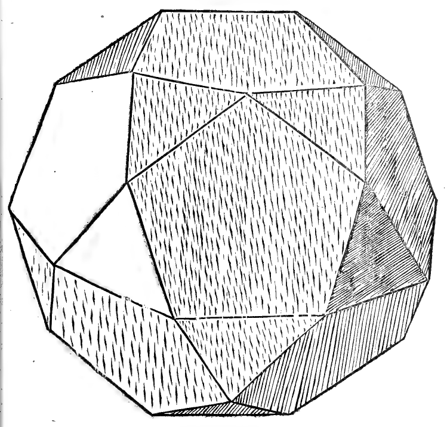

:layout: book
:canonical_id: Plate XXIX
:folio: 0247

.. _plates-polyhedra-plate_29:
.. _plates-polyhedra-plate_29-en:

Plate XXIX (Folio 0247) — Solid Truncated Dodecahedron (Icosidodecahedron)
==========================================================================

.. rubric:: Perspective Woodcut by Leonardo da Vinci (1509)

.. folio:: 0247

   **Solid Truncated Dodecahedron (Icosidodecahedron)** — :term:`*Dodecahedron Abscisum Solidum* <dodecahedron-abscisum>` (:term:`Δωδεκάεδρον ἀποτετμημένον <dodecahedron-abscisum>` :term:`στερεόν <solidum>`)
