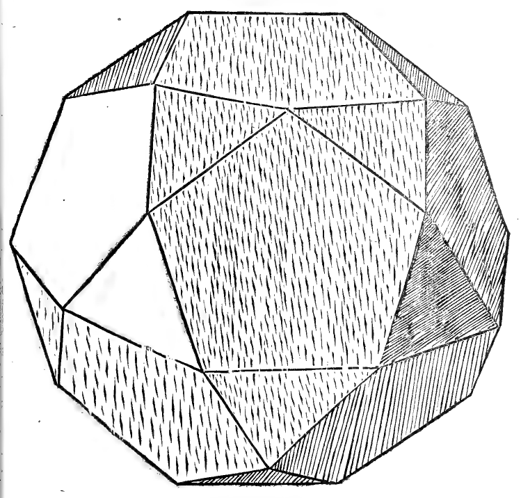

:layout: book
:canonical_id: Tabula XXIX
:folio: 0247

.. _plates-polyhedra-plate_29-la:

Tabula XXIX (Folio 0247) — Dodecahedron Abscisum Solidum
========================================================

.. rubric:: Figura Geometrica per Manum Leonardi Vincii (1509)

.. folio:: 0247

   :term:`*Dodecahedron Abscisum Solidum* <dodecahedron-abscisum>` (:term:`Δωδεκάεδρον ἀποτετμημένον <dodecahedron-abscisum>` :term:`στερεόν <solidum>`)
