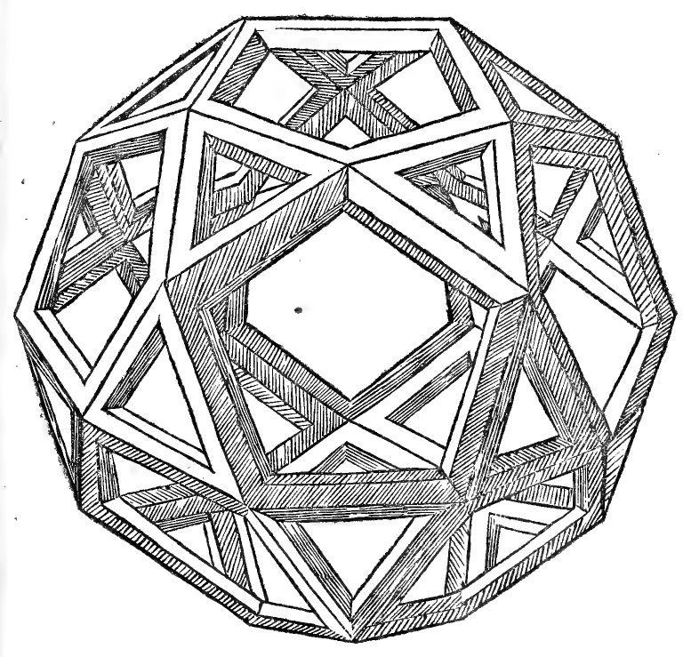

:layout: book
:canonical_id: Plate XXX
:folio: 0249

.. _plates-polyhedra-plate_30:
.. _plates-polyhedra-plate_30-en:

Plate XXX (Folio 0249) — Hollow Truncated Dodecahedron (Icosidodecahedron)
==========================================================================

.. rubric:: Perspective Woodcut by Leonardo da Vinci (1509)

.. folio:: 0249

   **Hollow Truncated Dodecahedron (Icosidodecahedron)** — :term:`*Dodecahedron Abscisum Vacuum* <dodecahedron-abscisum>` (:term:`Δωδεκάεδρον ἀποτετμημένον <dodecahedron-abscisum>` :term:`κενόν <vacuum>`)
