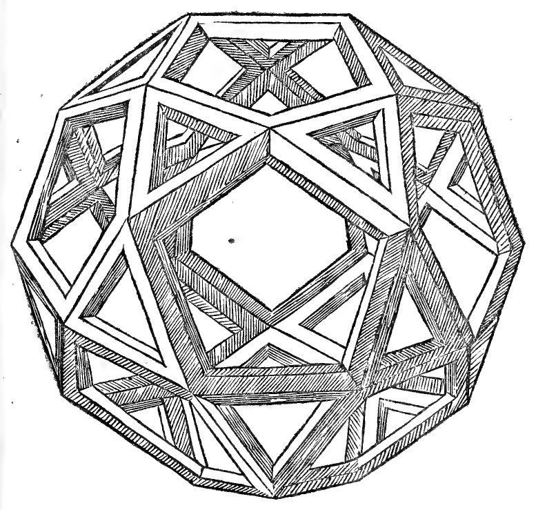

:layout: book
:canonical_id: Tabula XXX
:folio: 0249

.. _plates-polyhedra-plate_30-la:

Tabula XXX (Folio 0249) — Dodecahedron Abscisum Vacuum
======================================================

.. rubric:: Figura Geometrica per Manum Leonardi Vincii (1509)

.. folio:: 0249

   :term:`*Dodecahedron Abscisum Vacuum* <dodecahedron-abscisum>` (:term:`Δωδεκάεδρον ἀποτετμημένον <dodecahedron-abscisum>` :term:`κενόν <vacuum>`)
