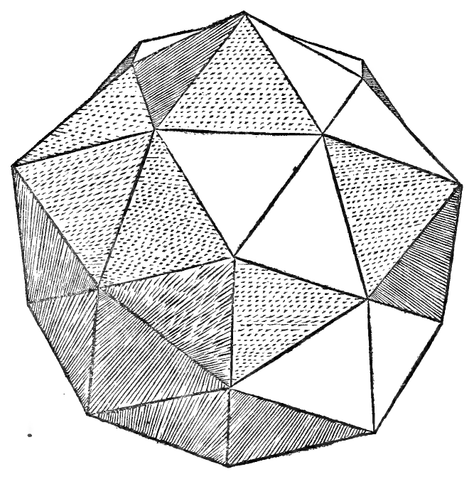

:layout: book
:canonical_id: Plate XXXI
:folio: 0251

.. _plates-polyhedra-plate_31:
.. _plates-polyhedra-plate_31-en:

Plate XXXI (Folio 0251) — Solid Elevated Dodecahedron
=====================================================

.. rubric:: Perspective Woodcut by Leonardo da Vinci (1509)

.. folio:: 0251

   **Solid Elevated Dodecahedron** — :term:`*Dodecahedron Elevatum Solidum* <dodecahedron-elevatum>` (:term:`Δωδεκάεδρον ἐπηρμένον <dodecahedron-elevatum>` :term:`στερεόν <solidum>`)
