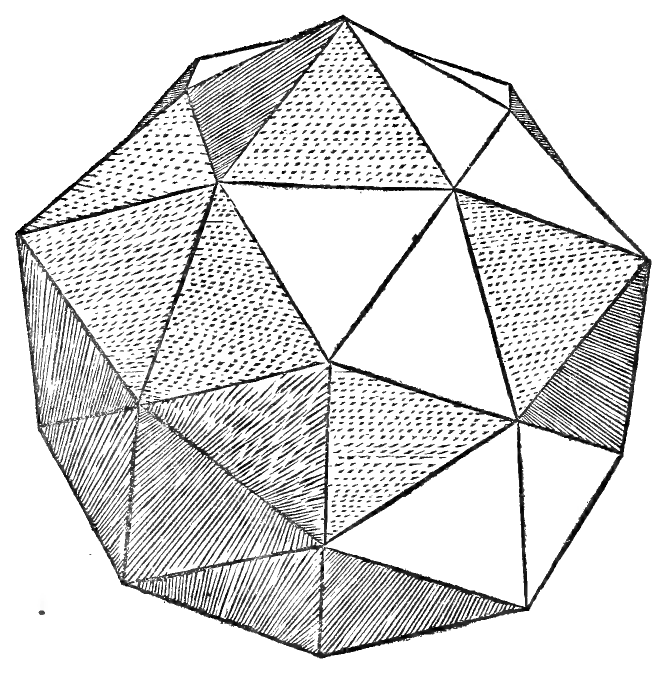

:layout: book
:canonical_id: Tabula XXXI
:folio: 0251

.. _plates-polyhedra-plate_31-la:

Tabula XXXI (Folio 0251) — Dodecahedron Elevatum Solidum
========================================================

.. rubric:: Figura Geometrica per Manum Leonardi Vincii (1509)

.. folio:: 0251

   :term:`*Dodecahedron Elevatum Solidum* <dodecahedron-elevatum>` (:term:`Δωδεκάεδρον ἐπηρμένον <dodecahedron-elevatum>` :term:`στερεόν <solidum>`)
