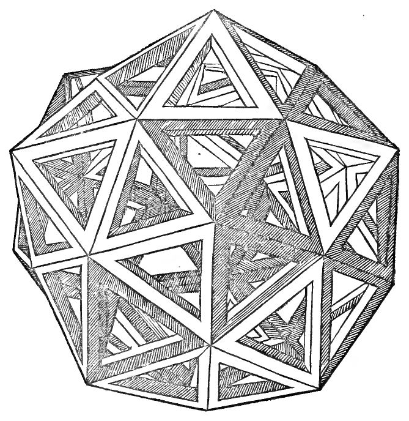

:layout: book
:canonical_id: Plate XXXII
:folio: 0253

.. _plates-polyhedra-plate_32:
.. _plates-polyhedra-plate_32-en:

Plate XXXII (Folio 0253) — Hollow Elevated Dodecahedron
=======================================================

.. rubric:: Perspective Woodcut by Leonardo da Vinci (1509)

.. folio:: 0253

   **Hollow Elevated Dodecahedron** — :term:`*Dodecahedron Elevatum Vacuum* <dodecahedron-elevatum>` (:term:`Δωδεκάεδρον ἐπηρμένον <dodecahedron-elevatum>` :term:`κενόν <vacuum>`)
