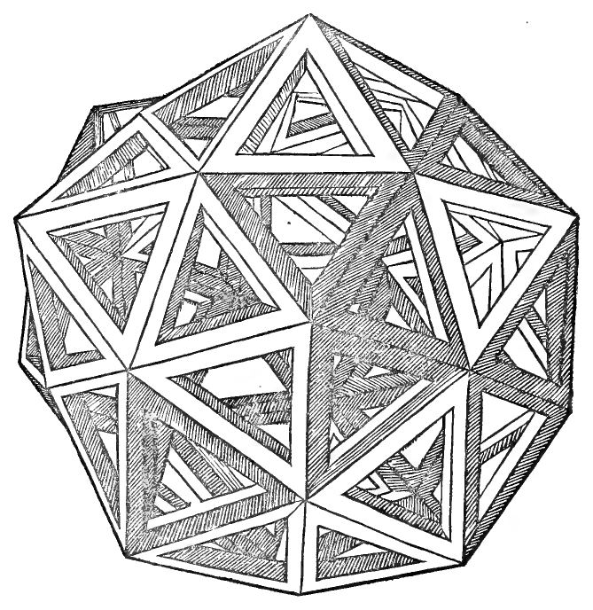

:layout: book
:canonical_id: Tabula XXXII
:folio: 0253

.. _plates-polyhedra-plate_32-la:

Tabula XXXII (Folio 0253) — Dodecahedron Elevatum Vacuum
========================================================

.. rubric:: Figura Geometrica per Manum Leonardi Vincii (1509)

.. folio:: 0253

   :term:`*Dodecahedron Elevatum Vacuum* <dodecahedron-elevatum>` (:term:`Δωδεκάεδρον ἐπηρμένον <dodecahedron-elevatum>` :term:`κενόν <vacuum>`)
