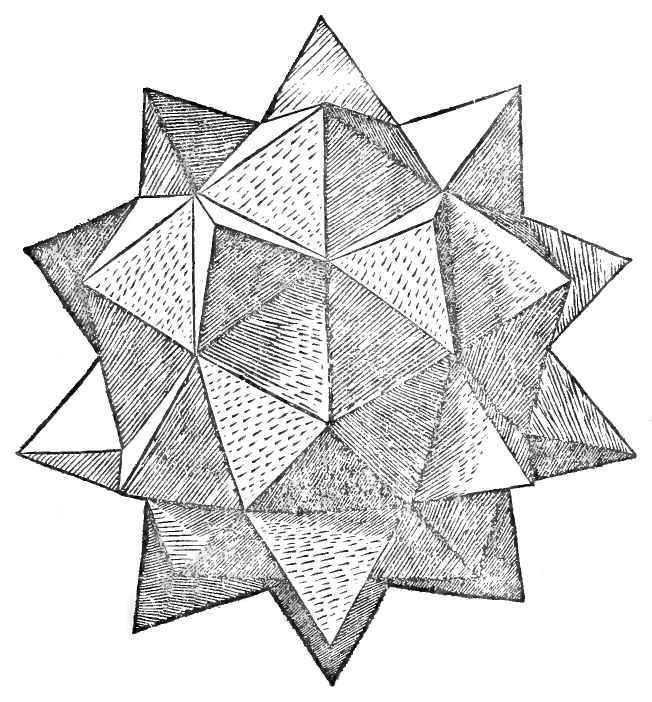

:layout: book
:canonical_id: Plate XXXIII
:folio: 0255

.. _plates-polyhedra-plate_33:
.. _plates-polyhedra-plate_33-en:

Plate XXXIII (Folio 0255) — Solid Elevated Truncated Dodecahedron
=================================================================

.. rubric:: Perspective Woodcut by Leonardo da Vinci (1509)

.. folio:: 0255

   **Solid Elevated Truncated Dodecahedron** — :term:`*Dodecahedron Abscisum Elevatum Solidum* <dodecahedron-abscisum-elevatum>` (:term:`Δωδεκάεδρον ἀποτετμημένον ἐπηρμένον <dodecahedron-abscisum-elevatum>` :term:`στερεόν <solidum>`)
