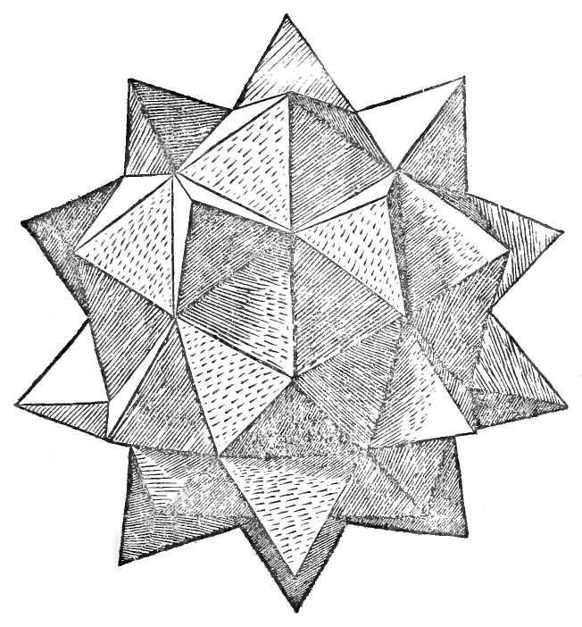

:layout: book
:canonical_id: Tabula XXXIII
:folio: 0255

.. _plates-polyhedra-plate_33-la:

Tabula XXXIII (Folio 0255) — Dodecahedron Abscisum Elevatum Solidum
===================================================================

.. rubric:: Figura Geometrica per Manum Leonardi Vincii (1509)

.. folio:: 0255

   :term:`*Dodecahedron Abscisum Elevatum Solidum* <dodecahedron-abscisum-elevatum>` (:term:`Δωδεκάεδρον ἀποτετμημένον ἐπηρμένον <dodecahedron-abscisum-elevatum>` :term:`στερεόν <solidum>`)
