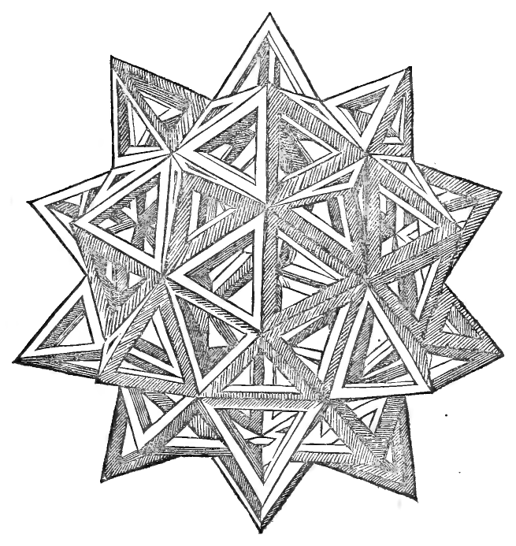

:layout: book
:canonical_id: Plate XXXIIII
:folio: 0257

.. _plates-polyhedra-plate_34:
.. _plates-polyhedra-plate_34-en:

Plate XXXIIII (Folio 0257) — Hollow Elevated Truncated Dodecahedron
===================================================================

.. rubric:: Perspective Woodcut by Leonardo da Vinci (1509)

.. folio:: 0257

   **Hollow Elevated Truncated Dodecahedron** — :term:`*Dodecahedron Abscisum Elevatum Vacuum* <dodecahedron-abscisum-elevatum>` (:term:`Δωδεκάεδρον ἀποτετμημένον ἐπηρμένον <dodecahedron-abscisum-elevatum>` :term:`κενόν <vacuum>`)
