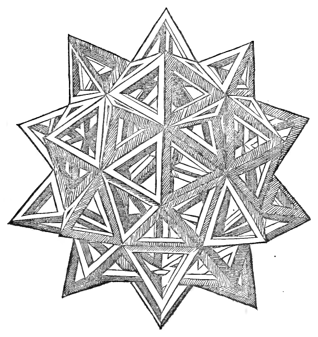

:layout: book
:canonical_id: Tabula XXXIIII
:folio: 0257

.. _plates-polyhedra-plate_34-la:

Tabula XXXIIII (Folio 0257) — Dodecahedron Abscisum Elevatum Vacuum
===================================================================

.. rubric:: Figura Geometrica per Manum Leonardi Vincii (1509)

.. folio:: 0257

   :term:`*Dodecahedron Abscisum Elevatum Vacuum* <dodecahedron-abscisum-elevatum>` (:term:`Δωδεκάεδρον ἀποτετμημένον ἐπηρμένον <dodecahedron-abscisum-elevatum>` :term:`κενόν <vacuum>`)
