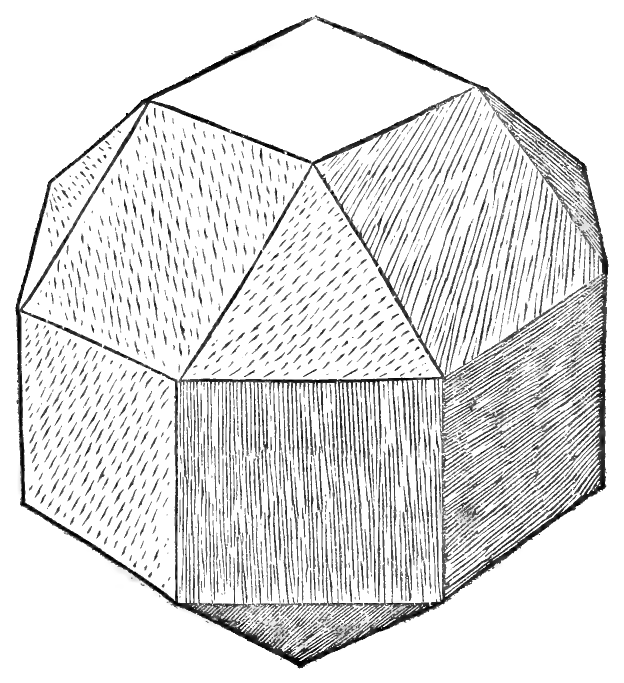

:layout: book
:canonical_id: Plate XXXV
:folio: 0259

.. _plates-polyhedra-plate_35:
.. _plates-polyhedra-plate_35-en:

Plate XXXV (Folio 0259) — Solid 26-Base Body (Rhombicuboctahedron)
==================================================================

.. rubric:: Perspective Woodcut by Leonardo da Vinci (1509)

.. folio:: 0259

   **Solid 26-Base Body (Rhombicuboctahedron)** — :term:`*Vigintisex Basium Planum Solidum* <vigintisex-basium>` (:term:`Εἰκοσιεξάεδρον <vigintisex-basium>` :term:`ἐπίπεδον <planum>` :term:`στερεόν <solidum>`)
