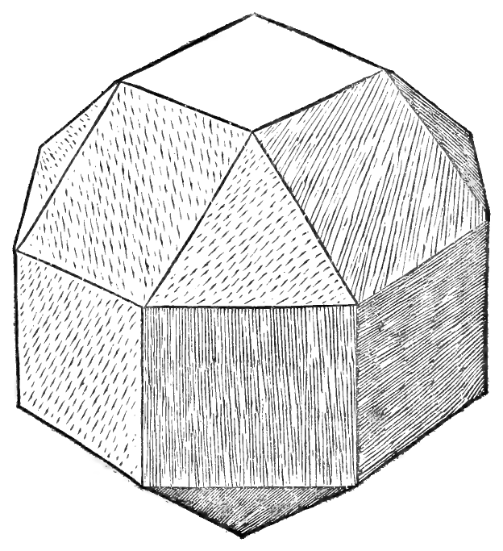

:layout: book
:canonical_id: Tabula XXXV
:folio: 0259

.. _plates-polyhedra-plate_35-la:

Tabula XXXV (Folio 0259) — Vigintisex Basium Planum Solidum
===========================================================

.. rubric:: Figura Geometrica per Manum Leonardi Vincii (1509)

.. folio:: 0259

   :term:`*Vigintisex Basium Planum Solidum* <vigintisex-basium>` (:term:`Εἰκοσιεξάεδρον <vigintisex-basium>` :term:`ἐπίπεδον <planum>` :term:`στερεόν <solidum>`)
