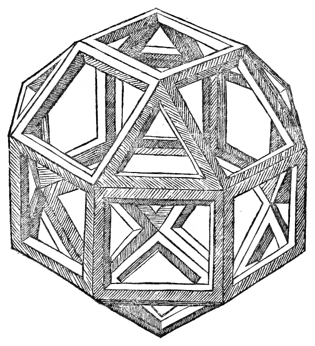

:layout: book
:canonical_id: Plate XXXVI
:folio: 0261

.. _plates-polyhedra-plate_36:
.. _plates-polyhedra-plate_36-en:

Plate XXXVI (Folio 0261) — Hollow 26-Base Body (Rhombicuboctahedron)
====================================================================

.. rubric:: Perspective Woodcut by Leonardo da Vinci (1509)

.. folio:: 0261

   **Hollow 26-Base Body (Rhombicuboctahedron)** — :term:`*Vigintisex Basium Planum Vacuum* <vigintisex-basium>` (:term:`Εἰκοσιεξάεδρον <vigintisex-basium>` :term:`ἐπίπεδον <planum>` :term:`κενόν <vacuum>`)
