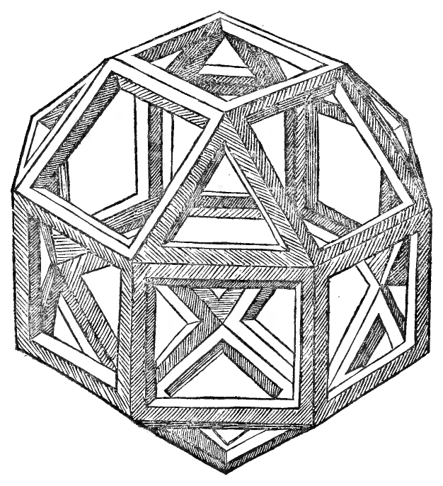

:layout: book
:canonical_id: Tabula XXXVI
:folio: 0261

.. _plates-polyhedra-plate_36-la:

Tabula XXXVI (Folio 0261) — Vigintisex Basium Planum Vacuum
===========================================================

.. rubric:: Figura Geometrica per Manum Leonardi Vincii (1509)

.. folio:: 0261

   :term:`*Vigintisex Basium Planum Vacuum* <vigintisex-basium>` (:term:`Εἰκοσιεξάεδρον <vigintisex-basium>` :term:`ἐπίπεδον <planum>` :term:`κενόν <vacuum>`)
