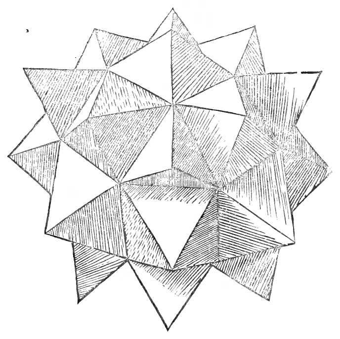

:layout: book
:canonical_id: Plate XXXVII
:folio: 0263

.. _plates-polyhedra-plate_37:
.. _plates-polyhedra-plate_37-en:

Plate XXXVII (Folio 0263) — Solid Elevated 26-Base Body
=======================================================

.. rubric:: Perspective Woodcut by Leonardo da Vinci (1509)

.. folio:: 0263

   **Solid Elevated 26-Base Body** — :term:`*Vigintisex Basium Abscisum Elevatum Solidum* <vigintisex-basium>` (:term:`Εἰκοσιεξάεδρον <vigintisex-basium>` :term:`ἀποτετμημένον <abscisum>` :term:`ἐπηρμένον <elevatum>` :term:`στερεόν <solidum>`)
