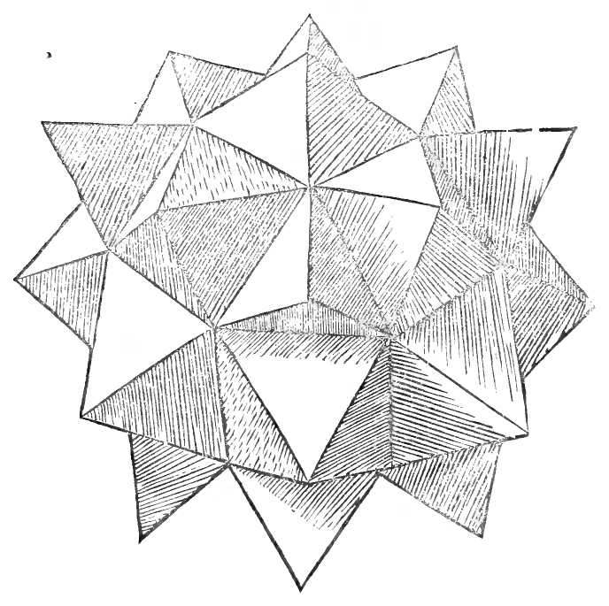

:layout: book
:canonical_id: Tabula XXXVII
:folio: 0263

.. _plates-polyhedra-plate_37-la:

Tabula XXXVII (Folio 0263) — Vigintisex Basium Abscisum Elevatum Solidum
========================================================================

.. rubric:: Figura Geometrica per Manum Leonardi Vincii (1509)

.. folio:: 0263

   :term:`*Vigintisex Basium Abscisum Elevatum Solidum* <vigintisex-basium>` (:term:`Εἰκοσιεξάεδρον <vigintisex-basium>` :term:`ἀποτετμημένον <abscisum>` :term:`ἐπηρμένον <elevatum>` :term:`στερεόν <solidum>`)
