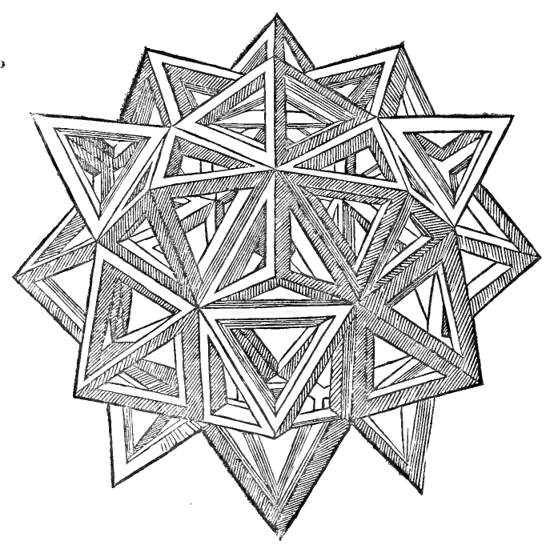

:layout: book
:canonical_id: Plate XXXVIII
:folio: 0265

.. _plates-polyhedra-plate_38:
.. _plates-polyhedra-plate_38-en:

Plate XXXVIII (Folio 0265) — Hollow Elevated 26-Base Body
=========================================================

.. rubric:: Perspective Woodcut by Leonardo da Vinci (1509)

.. folio:: 0265

   **Hollow Elevated 26-Base Body** — :term:`*Vigintisex Basium Abscisum Elevatum Vacuum* <vigintisex-basium>` (:term:`Εἰκοσιεξάεδρον <vigintisex-basium>` :term:`ἀποτετμημένον <abscisum>` :term:`ἐπηρμένον <elevatum>` :term:`κενόν <vacuum>`)
