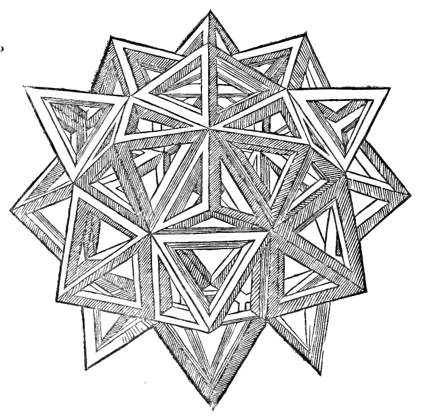

:layout: book
:canonical_id: Tabula XXXVIII
:folio: 0265

.. _plates-polyhedra-plate_38-la:

Tabula XXXVIII (Folio 0265) — Vigintisex Basium Abscisum Elevatum Vacuum
========================================================================

.. rubric:: Figura Geometrica per Manum Leonardi Vincii (1509)

.. folio:: 0265

   :term:`*Vigintisex Basium Abscisum Elevatum Vacuum* <vigintisex-basium>` (:term:`Εἰκοσιεξάεδρον <vigintisex-basium>` :term:`ἀποτετμημένον <abscisum>` :term:`ἐπηρμένον <elevatum>` :term:`κενόν <vacuum>`)
