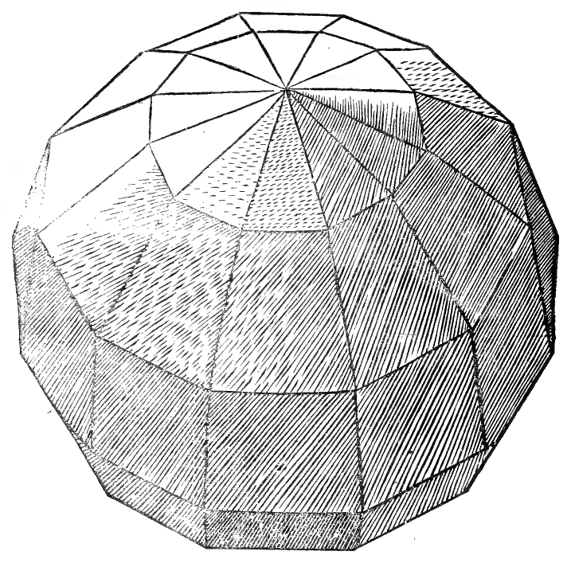

:layout: book
:canonical_id: Plate XXXIX
:folio: 0267

.. _plates-polyhedra-plate_39:
.. _plates-polyhedra-plate_39-en:

Plate XXXIX (Folio 0267) — Solid 72-Base Body
=============================================

.. rubric:: Perspective Woodcut by Leonardo da Vinci (1509)

.. folio:: 0267

   **Solid 72-Base Body** — :term:`*Septuaginta Duarum Basium Solidum* <septuaginta-duarum-basium>` (:term:`Ἑβδομηκονταδισσάεδρον <septuaginta-duarum-basium>` :term:`στερεόν <solidum>`)
