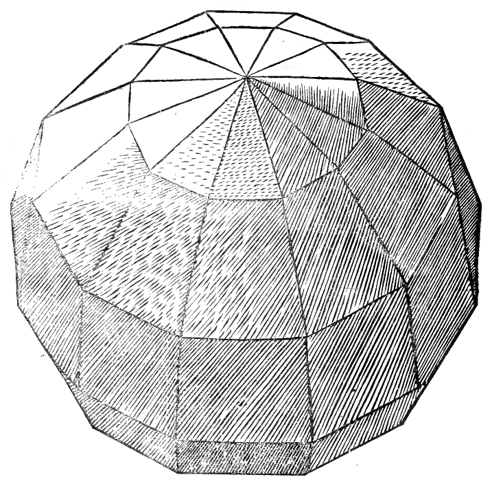

:layout: book
:canonical_id: Tabula XXXIX
:folio: 0267

.. _plates-polyhedra-plate_39-la:

Tabula XXXIX (Folio 0267) — Septuaginta Duarum Basium Solidum
=============================================================

.. rubric:: Figura Geometrica per Manum Leonardi Vincii (1509)

.. folio:: 0267

   :term:`*Septuaginta Duarum Basium Solidum* <septuaginta-duarum-basium>` (:term:`Ἑβδομηκονταδισσάεδρον <septuaginta-duarum-basium>` :term:`στερεόν <solidum>`)
