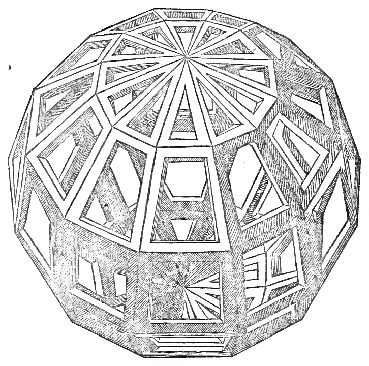

:layout: book
:canonical_id: Plate XL
:folio: 0269

.. _plates-polyhedra-plate_40:
.. _plates-polyhedra-plate_40-en:

Plate XL (Folio 0269) — Hollow 72-Base Body
===========================================

.. rubric:: Perspective Woodcut by Leonardo da Vinci (1509)

.. folio:: 0269

   **Hollow 72-Base Body** — :term:`*Septuaginta Duarum Basium Vacuum* <septuaginta-duarum-basium>` (:term:`Ἑβδομηκονταδισσάεδρον <septuaginta-duarum-basium>` :term:`κενόν <vacuum>`)
